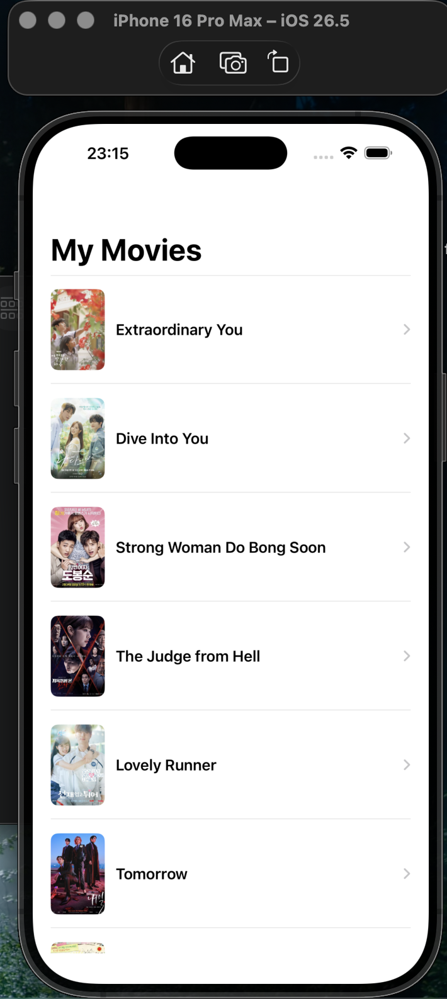
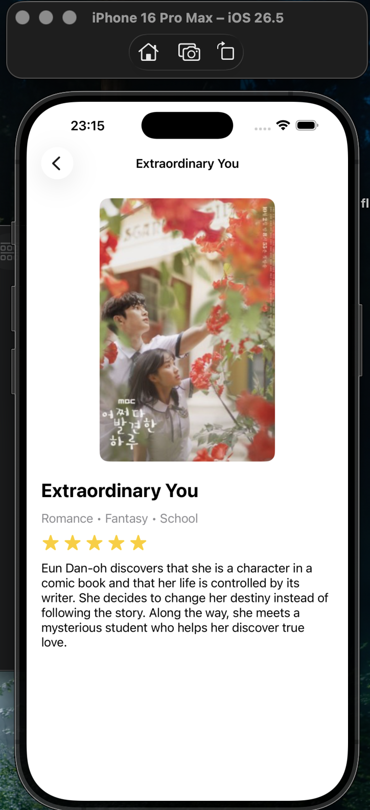
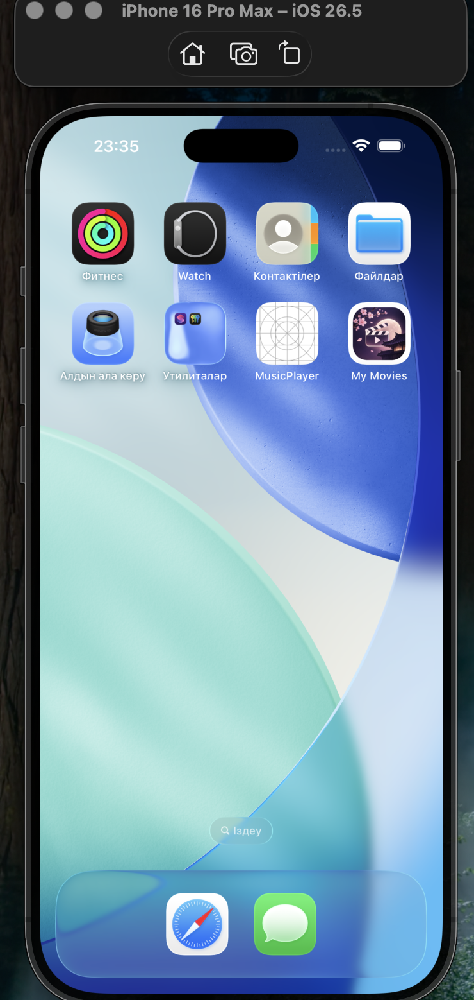

# Lab 10 — Favorites Navigator

**Student:** Assiya Kengesbay  
**Theme:** My Favorite K-Dramas  
**Platform:** iOS (UIKit, Swift)

## Description

Favorites Navigator is an iOS application that displays a collection of 20 favorite Korean dramas.

The main screen shows a list of dramas using UITableView and custom cells. Users can tap a drama to open a detail screen with its poster, title, genre, rating, and description.

The application uses UINavigationController and a Show segue for navigation. The interface and Auto Layout are configured in Main.storyboard.

## Screenshots

### List Screen

### Detail Screen

### Launch Screen

### App Icon

